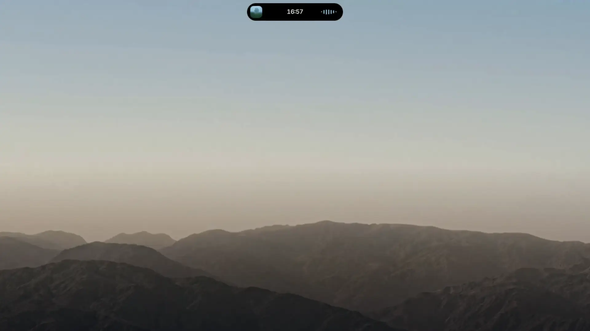
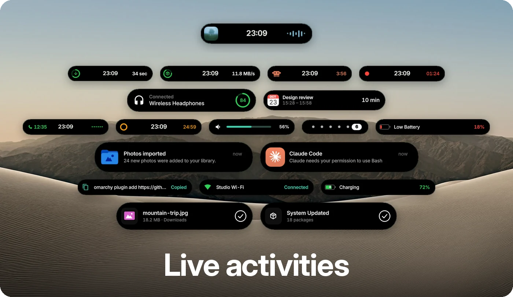
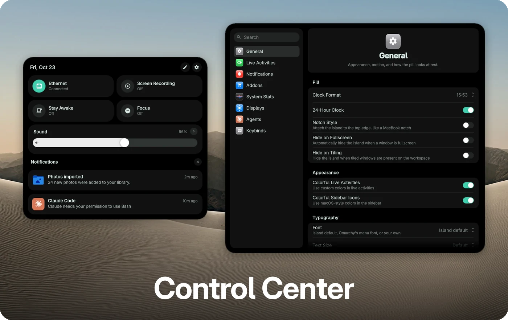
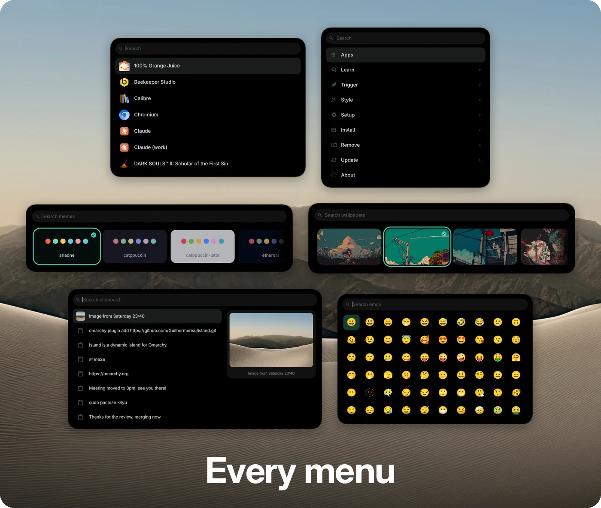
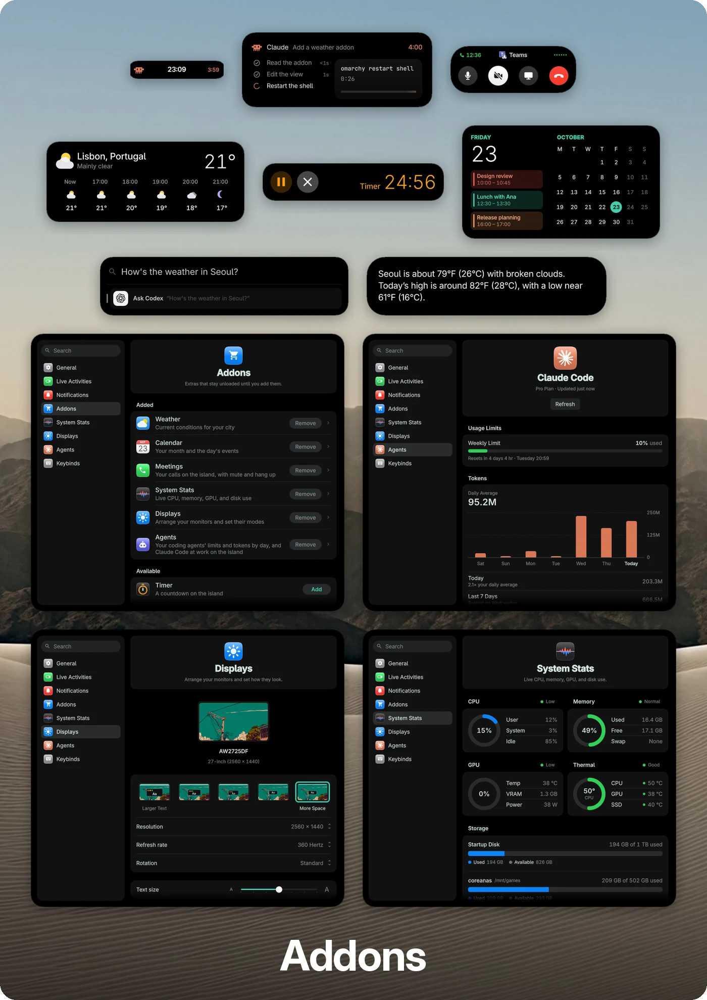

<p align="center">
  
</p>

<p align="center">
  <a href="https://github.com/Guilhermerisu/island/stargazers"></a>
  <a href="https://github.com/Guilhermerisu/island/commits"></a>
  <a href="LICENSE"></a>
</p>

<a id="install"></a>
<h2 align="center">Install</h2>

```sh
omarchy plugin add https://github.com/Guilhermerisu/island.git
omarchy bar use guilhermerisu.island
```

<br>

<a id="features"></a>
<h2 align="center">Features</h2>

<p align="center">
  
</p>

<br>

<p align="center">
  
</p>

<br>

<p align="center">
  
</p>

<br>

<p align="center">
  
</p>

<br>

<a id="faq"></a>
<h2 align="center">FAQ</h2>

<details>
<summary><b>Do my other Omarchy plugins still work?</b></summary>
<br>

Plugins that add their own panel, overlay, or menu keep working. Open the
Plugins view (Settings → Keybinds, or the Plugins addon) to enable one and open
it.

Plugins that add a **bar widget** can't show while Island is the bar, since
Island doesn't render other plugins' widgets.
</details>

<details>
<summary><b>Can I turn off a live activity I don't want?</b></summary>
<br>

Yes. Each one has its own switch in Settings → Live Activities: Now Playing,
Play & Pause, Workspace Indicator, Downloads, Screen Recording, System Updates,
Bluetooth Devices, Network, Battery, Volume, Brightness, and Clipboard.
</details>

<details>
<summary><b>Can I change the keyboard shortcuts?</b></summary>
<br>

Yes. Open Settings → Keybinds, pick a shortcut, and press the new keys. An
addon's shortcuts are set in its options on the Addons page.
</details>

<details>
<summary><b>How does Island update?</b></summary>
<br>

Island checks GitHub shortly after the shell starts and then every six hours.
When a new version is out, the island shows **Island Update: A new version is
ready. Click to update.** Click it, and Island updates and restarts the shell.
This needs the plugin to be a git checkout, which `omarchy plugin add` gives
you, with no local changes.
</details>

<details>
<summary><b>Can it look like a MacBook notch?</b></summary>
<br>

Yes. Turn on **Notch Style** in Settings → General to attach the island to the
top edge of the screen.
</details>

<details>
<summary><b>Can Island show Codex CLI sessions?</b></summary>

<br>

Codex Sessions lists active local Codex CLI sessions from every workspace. It
shows the workspace number. It sends notices when a session finishes or needs a
reply. Set its shortcut in **Settings → Keybinds**.

Permission notices need the Codex `PermissionRequest` hook. The hook calls
`addons/codex/codex-permission-notify.py`. It reports the workspace, session
name, and requested action. Codex still shows its normal approval prompt.
</details>

<details>
<summary><b>How do I uninstall it?</b></summary>
<br>

## Uninstall

```sh
bash ~/.config/omarchy/plugins/guilhermerisu.island/companion/uninstall.sh
```

It switches back to the stock bar, removes the notification companion
(Omarchy's own notifications come back), undoes the `shell.json` and Omarchy
menu changes the setup made, deletes `island-bindings.lua`, removes Island, and
restarts the shell.
</details>

<br>

<p align="center"><sub>Released under the <a href="LICENSE">MIT license</a>.</sub></p>
